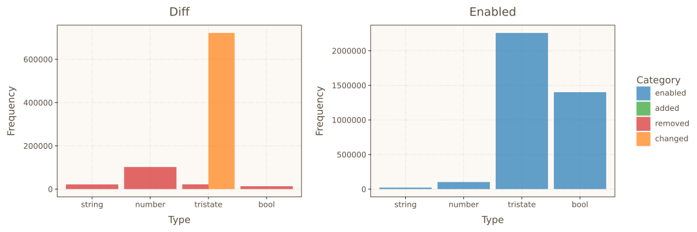
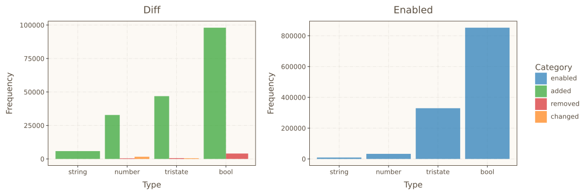

# Evaluating The Accuracy of Linux Kernel Configuration Translations

**Bachelor's thesis project:** a tool for measuring how faithfully Linux kernel
configurations can be translated between their two representations: the logical
formula extracted from Kconfig files (a *model*) and the `.config` file consumed
by the kernel build system.


---

## Overview

The Linux kernel is configured through [Kconfig](https://www.kernel.org/doc/html/latest/kbuild/kconfig-language.html),
whose files describe hundreds of interdependent configuration symbols. Those
dependencies can be extracted into a logical formula (a *model*) and solved
with an SMT solver. Conversely, the kernel build system produces `.config`
files. **How accurate are the translations between these two worlds?**

This project answers that question empirically. It translates in both
directions, diffs the results symbol-by-symbol, and aggregates statistics per
symbol type (`bool`, `tristate`, `number`, `string`) and per category
(`changed`, `removed`, `added`, `enabled`). It also chains both directions into
*round-trips* to measure how much configuration information is lost over a full
cycle.

### Highlights

- **Both translation directions**, plus round-trips, in a single tool
- **SMT-based**: constraint extraction and model sampling with Z3 via the
  [kmax](https://github.com/paulgazz/kmax) tool suite
- **Reproducible by design**: seeded sampling (Z3 `random_seed` +
  `KCONFIG_SEED`), pinned dependencies, constraint caching, and a one-command
  Docker setup
- **Publication-style output**: per-type diff tables and plots (data points,
  boxplots, violin plots, ECDF, totals) generated with plotnine

## How It Works

### Model → Config (M2C)

```
Kconfig files ──klocalizer──► SMT constraints ──Z3──► satisfying model
                                                              │
                                                              ▼
                                        rendered .config ──make olddefconfig──► normalized .config
                                                              │
                                                              ▼
                                                   per-symbol diff + statistics
```

1. Extract the Kconfig constraints for an architecture with `klocalizer`.
2. Sample a random *satisfying model* of those constraints with Z3 (seeded).
3. Render the model as a `.config` file.
4. Normalize it with `make olddefconfig` - this is what the build system would
   actually consume.
5. Diff input vs. normalized output, per symbol and per type.

### Config → Model (C2M)

1. Generate a random configuration with `make randconfig` (seeded).
2. Check the configuration against the extracted constraints with Z3.
3. If it is unsatisfiable, repair it *minimally* using unsat-core extraction -
   removing or adding the fewest symbols needed to restore satisfiability.
4. Diff the original vs. the repaired configuration.

### Round-Trips

Each direction is chained into the other (M2C → C2M and C2M → M2C) to measure
how much of the original configuration survives a full translation cycle.

## Results

From a sample run (Linux 6.18.16, `x86_64`, 1000 configurations, seed 0 - see
[`results/`](results/)):

| Evaluation             | Changed | Removed | Added |
| ---------------------- | ------- | ------- | ----- |
| Model → Config         | 0.17%   | 0.42%   | 15.0% |
| Config → Model         | 19.09%  | 4.19%   | 0%    |
| M2C round-trip         | 0%      | 3.83%   | 11.8% |
| C2M round-trip         | 18.48%  | 1.44%   | 0.11% |

Notable findings:

- **C2M flips ~32% of `tristate` symbols** (`m` → `y`): the solver normalizes
  module symbols to built-in ones, since module-ness is not constrained by the
  boolean formula.
- **`number` and `string` symbols are always removed in C2M** - they do not
  affect boolean satisfiability, so the solver drops them.
- **M2C adds ~15% of symbols**: `olddefconfig` fills in defaults for symbols the
  model left unset.
- **Round-trips are not lossless** - a full cycle changes ~18% of all symbols.

### Plots

Aggregated totals per symbol type for the **Config → Model** evaluation - note how
the `changed` category (orange) is dominated by `tristate` symbols:



The underlying per-configuration data points (jittered, with mean markers) show
that the `m` → `y` tristate flips are systematic, not outliers:


For contrast, the **Model → Config** direction is nearly lossless - `olddefconfig`
only adds defaults for symbols the model left unset:



Each run also generates boxplots, violin plots, and cumulative frequency graphs
under `results/<evaluation>/plots/`.

## Tech Stack

| Layer      | Technology                                             |
| ---------- | ------------------------------------------------------ |
| Language   | Python 3.13                                            |
| SMT solving| Z3 (`z3-solver` 4.16) via the kmax tool suite          |
| Kconfig    | `klocalizer` / `kclause` (constraint extraction, model sampling) |
| Data       | pandas, numpy                                           |
| Plotting   | plotnine (ggplot2-style)                               |
| CLI / UX   | rich (tables, logging), argparse                        |
| Packaging  | Docker, pinned `requirements.txt` + `constraints.txt`  |
| Kernel     | Linux build system (`make olddefconfig`, `make randconfig`) |

## Getting Started

### Quick Start with Docker

The image bundles the kernel source and all dependencies - no local setup
needed.

**Requirements:** docker, git

```bash
git clone https://github.com/NawarBaddour/Evaluating-The-Accuracy-of-Linux-Kernel-Configuration-Translations.git
cd evaluating-the-accuracy-of-linux-kernel-configuration-translations

# Build the image
docker build -t evaluate .

# Run the evaluation (results are written to ./results)
docker run --rm -e PUID=$(id -u) -e PGID=$(id -g) -tv $(pwd)/results:/evaluate/results evaluate
```

### Manual Setup

**Requirements:** python, pip, git, curl, tar

#### 1. Clone the Repository

```bash
git clone https://github.com/NawarBaddour/Evaluating-The-Accuracy-of-Linux-Kernel-Configuration-Translations.git
cd evaluating-the-accuracy-of-linux-kernel-configuration-translations
```

#### 2. Get the Linux Kernel Source

```bash
mkdir ../linux-6.18.16
curl -fL https://cdn.kernel.org/pub/linux/kernel/v6.x/linux-6.18.16.tar.xz | tar --strip-components=1 -xJC ../linux-6.18.16
```

#### 3. Create a Python Virtual Environment

```bash
python -m venv .venv
source .venv/bin/activate
```

#### 4. Install Dependencies

```bash
pip install -r requirements.txt --build-constraint constraints.txt -c constraints.txt
```

### Usage

Run all evaluations (both directions + round-trips):

```bash
python -m evaluate --linux-ksrc ../linux-6.18.16 --arch x86_64 --num-configs 1000 --seed 0 --verbose
```

Useful options:

| Option             | Description                                              |
| ------------------ | -------------------------------------------------------- |
| `--linux-ksrc`     | Path to the Linux kernel source directory                |
| `--arch`           | Architecture to evaluate (default: `x86_64`)             |
| `--eval`           | What to evaluate: `M2C`, `C2M`, or both (default: both)  |
| `--roundtrip` / `--noroundtrip` | Enable or disable round-trips (default: enabled) |
| `--num-configs`    | Number of configurations to generate (default: 1)        |
| `--seed`           | Random seed for sampling and `make randconfig`           |
| `--output-dir`     | Output directory (default: `./results`)                  |
| `--cache-dir`      | Constraint cache directory (default: `./kmax.cache`)     |
| `-v` / `-q`        | Verbose / quiet logging                                  |

All results (configs, diffs, statistics, plots, and logs) are saved in
`./results/run_<timestamp>/`.

## Project Structure

```
.
├── evaluate/              # Evaluation tool
│   ├── __main__.py        # Entry point
│   ├── cli.py             # Argument parsing and orchestration
│   ├── evaluator.py       # Shared statistics and category definitions
│   ├── model_to_config.py # Model → Config evaluation
│   ├── config_to_model.py # Config → Model evaluation
│   ├── logger.py          # rich-based logging
│   ├── plot_theme.py      # Plot styling
│   └── utils.py           # Helpers
├── kmax/                  # kmax tool suite (Kconfig → SMT, Z3 sampling)
├── results/               # Sample run output
├── Dockerfile             # Reproducible environment
├── entrypoint.sh          # Container entrypoint (runs as unprivileged user)
├── requirements.txt       # Pinned dependencies
└── constraints.txt        # Pinned transitive build constraints
```

## Acknowledgments

Built on the [kmax](https://github.com/paulgazz/kmax) tool suite by Paul
Gazzillo et al., which provides Kconfig constraint extraction (`kclause`) and
SMT-based model sampling (`klocalizer`).
